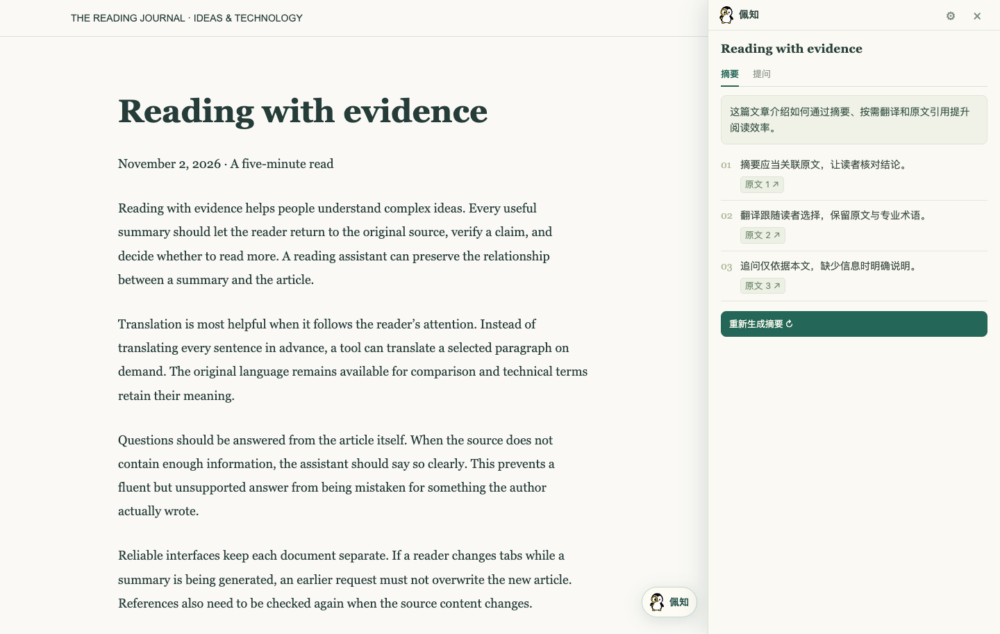
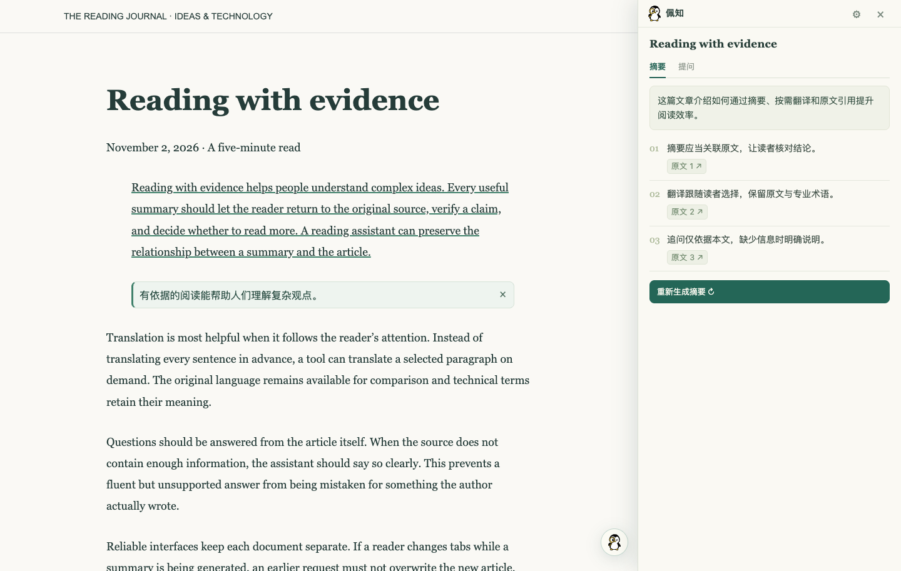

<p align="center"></p>

# 佩知 · Pagewise

你的网页阅读搭子。把英文长文读成中文摘要，在原文旁翻译，带着出处继续追问。

佩知是一个 Chrome 扩展，使用你自己的模型 API Key。点击网页右下角的小企鹅，即可打开阅读侧栏。

[下载最新安装包](https://github.com/MiracleZeroPenguin/pagewise-chrome/releases/latest) · [安装方法](#安装) · [模型设置](#模型设置)

## 能做什么

- **一键中文摘要**：提炼当前文章的概览和关键观点，点击引用回到对应原文。
- **选词翻译**：选中几个单词，自动补齐没有选全的单词；原文加下划线，悬停显示译文和浅绿色高亮。
- **整段翻译**：较长选区自动扩展到完整段落，中文显示在各段原文下面，宽度、左右留白和字号跟随原文。
- **基于文章提问**：「摘要」和「提问」分开呈现，问答支持多轮上下文和原文引用。
- **保留阅读状态**：同一页面收起再打开侧栏，摘要、问答、当前 Tab、草稿和滚动位置都会保留，不重复调用模型。
- **轻量界面**：悬浮按钮平时只显示图标，悬停展开名称；侧栏平滑滑入，等待时显示小企鹅动画，支持减少动态效果设置。





*截图使用演示文章和模拟模型回复。*

## 安装

需要 **Chrome 116 或更新版本**，以及可使用所选模型的 API Key。

1. 前往 [Releases](https://github.com/MiracleZeroPenguin/pagewise-chrome/releases/latest)，下载 `pagewise-chrome-版本号.zip`。不要选择 GitHub 自动生成的 `Source code`。
2. 解压 ZIP，把得到的 `pagewise-chrome-版本号` 文件夹放到固定位置。
3. 在 Chrome 地址栏打开 `chrome://extensions`，开启右上角「开发者模式」。
4. 点击「加载已解压的扩展程序」，选择上一步的文件夹（里面应直接包含 `manifest.json`）。
5. 刷新已有网页，点击右下角的小企鹅，进入侧栏右上角的设置，填写 API Key 并保存。

这是开发者模式安装包，无需编译，也无需运行安装脚本。安装后请保留解压文件夹；Chrome 会从该位置读取扩展。

### 更新

下载新版本并解压，用新文件替换**原来加载的文件夹内的内容**，然后在 `chrome://extensions` 点击佩知的「重新加载」，再刷新网页。保留同一加载路径，避免被识别为另一个扩展。

## 模型设置

| 设置 | 默认值 |
| --- | --- |
| 模型 | `glm-5.3-flash` |
| API 地址 | `https://open.bigmodel.cn/api/paas/v4/chat/completions` |
| API Key | 由你填写 |

可以修改模型名，或连接兼容 Chat Completions 的 HTTPS 服务。自定义接口首次保存时，Chrome 会请求该域名的访问权限。

点击「测试连接」只发送一句测试文字，不发送网页内容。模型是否可用、费用和限额取决于服务商及你的账号权限。

连接失败时会显示 HTTP 状态码，以及服务端 JSON 中的错误码和原因（如有）。404 不再统一提示稍后重试。错误详情以纯文本展示，并遮蔽当前 API Key；非 JSON 响应保留状态提示。排查时请提供错误提示和模型名称，不要提供密钥。

接口需支持标准 Chat Completions 返回结构，以及摘要和问答所用的 `response_format: {"type":"json_object"}`。`glm-5.3-flash`、`glm-5.3-flashx`、`glm-5.3-flashx-legal` 始终启用思考，佩知使用 `thinking: {"type":"enabled"}` 和 `reasoning_effort: "low"`；其他模型沿用 `thinking: {"type":"disabled"}`。不同服务的兼容程度可能不同。

## 使用提示

- 点击网页右下角的小企鹅或浏览器工具栏图标打开侧栏。点击 × 或按 Esc 收起。
- 选中文字后点击「翻译选文」。少量词语使用悬停译文，较长选文翻译完整段落；跨段选区逐段显示译文。
- 短词浮层移开鼠标或按 Esc 即可收起；段落译文可通过 × 移除。
- 在「提问」Tab 输入问题，Enter 发送，Shift + Enter 换行。无需先生成摘要。
- 摘要和回答中的「原文」按钮会滚动到对应段落并短暂高亮。
- 关闭侧栏后，已开始的生成任务会继续。刷新网页、导航、正文变化或模型设置变更可能使当前内容失效。

## 隐私

网页正文在本机提取。只有主动点击摘要、翻译、发送问题或测试连接时，才向配置的模型服务发送相应内容。

- 摘要发送文章标题、网址和提取的正文；问答还会发送问题及当前文章最近的对话。
- 短词翻译发送补齐后的选词；整段翻译发送选区涉及的完整可见段落。
- API Key 保存在本机 Chrome 扩展存储中，未额外加密；网页脚本和内容脚本不能读取。
- API Key 输入框留空保存会保留已有密钥；点击「删除密钥」才会移除。
- 没有账号系统、遥测、广告或云同步。发送给模型服务的内容由该服务按其政策处理。

## 已知限制

- 不支持 Chrome 内部页面、Chrome 网上应用店、内置 PDF 查看器等受保护页面，也不提供图片识别或 PDF OCR。
- 只处理当前页面可提取的正文；复杂布局、代码块、表格、动态网页和 iframe 内的文章可能提取不完整。表单及可编辑区域会被排除。
- 正文输入上限为 24,000 字符，超出时会提示；单段翻译上限为 6,000 字符，超长段落会提示而不截断翻译。
- 模型可能遗漏或误解内容，请结合引用核对原文。自动化验证使用模拟服务，不代表已验证真实模型账号的可用性。

## 本地开发

需要 Node.js 22+ 和 npm。打包安装文件另需 Python 3。

```bash
git clone git@github.com:MiracleZeroPenguin/pagewise-chrome.git
cd pagewise-chrome
npm ci
npm run build
```

在 `chrome://extensions` 中加载生成的 `dist/` 目录。

```bash
npm test                         # 单元测试
npx playwright install chromium  # 首次运行浏览器测试时安装
npm run test:e2e                  # 临时浏览器 + 模拟模型服务
npm run package                  # 构建并生成 ZIP 与 SHA-256 校验文件
```

浏览器测试使用临时用户配置，不修改日常浏览器数据，也不需要真实 API Key。发布文件生成在 `releases/`。

| 路径 | 用途 |
| --- | --- |
| `src/content.js` | 网页悬浮入口、嵌入式侧栏 |
| `src/panel.js` | 摘要、文章问答和界面状态 |
| `src/inline-translation.js` | 原文旁的翻译 |
| `src/background.js` | 扩展消息与受保护的模型调用 |
| `src/core.js` | 模型参数、提示词和回复解析 |
| `static/` | 界面、图标和加载动画 |
| `tests/` | 单元与浏览器测试 |
| `scripts/` | 构建、图标导出和发布打包 |

图标源文件为 `icon.svg`；修改后运行 `npm run icons` 重新导出 Chrome 所需的 PNG，再构建。运行时依赖及许可证见 [THIRD_PARTY_NOTICES.md](THIRD_PARTY_NOTICES.md)。
